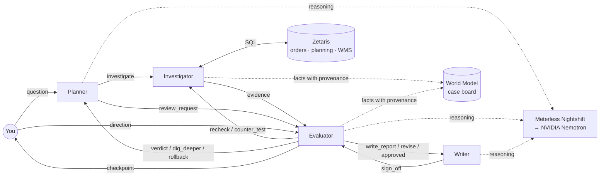

# Chain of Evidence

**Agents that explain why.** *Chain of thought guesses. Chain of evidence proves.*

A team of AI agents investigates why a product ran out of stock at a distribution
centre. The agents challenge each other until every conclusion rests on verified
data, and then they hand the analyst a root cause, the chain of evidence behind it,
and the owner who should act.

Built for the **Open Agent Hackathon 2026 (GenAI.Works)**, Track 2: *The Agent That Can Explain Why*.
Team: **Chain of Evidence** (solo).

---

## The problem

A stockout costs sales the day it happens. Finding out *why* it happened usually costs
an analyst a day or more: the order, planning and warehouse data live in different
systems, the obvious signal is often a symptom rather than the cause, and the final
explanation is rarely traceable back to the numbers.

Single-pass AI makes this worse. It will produce a confident answer from whatever it
sees first, and nothing checks that answer.

## What Chain of Evidence does

You ask, in plain language: *"Why did Herbana shampoo run out in Mumbai?"* (by product, brand,
SKU code, city or event id; vague questions are routed by Nemotron).

1. **The Planner** walks an expert root-cause tree for stockouts (supply, demand,
   inventory policy) and decides what to check next from what has been found so far.
2. **The Investigator** runs each check as SQL through **Zetaris**, joining four
   separate source systems (orders, planning, warehouse, finance) in place.
3. **The Evaluator** challenges everything:
   - recomputes every off-target number independently from the raw rows,
   - refuses "no cause found" and sends the team back to dig deeper,
   - tries to **disprove** each confirmed cause, and **rolls it back** if it is only a symptom,
   - vetoes any report claim that does not match the evidence.
4. **The Writer** first asks the Investigator for the business impact: what it cost, how
   early it was visible, and what the wrong fix would have cost.
5. **You** (optional) review the findings mid-investigation and steer the team, in
   buttons or in your own words.
6. **The Writer** drafts the report, and cannot publish it until the Evaluator signs off.

Every reasoning step runs on **NVIDIA Nemotron through Meterless Nightshift**, and every
model call carries a signed Meterless receipt.

Every answer leads with the business case:

- **What it cost**: demand lost in the 4 weeks from the first stockout, valued at an estimated
  net price, and how often stock ran out again (a cause that is still active).
- **Early warning**: when the cause's signal first went off target, week by week. OOS-001's
  transport delays were visible 21 days before the stockout.
- **Wrong fix avoided**: when a cause is rolled back as a symptom, what the obvious fix would have
  cost. For OOS-001, raising safety stock to absorb the delays: about ₹1.3 lakh of extra stock
  that would not have fixed them.
- **A concrete next step** per cause, written from the evidence, with its owner.

## Why it is a system, not a pipeline

The agents talk over a message bus and react to what they receive. There is no fixed
A → B → C sequence: the path through the tree depends on the data, and four feedback
loops send work backwards.

| Loop | From → to | What happens |
|---|---|---|
| Independent recheck | Evaluator → Investigator | An off-target number is accepted only if a second, row-level query recomputes the same value |
| Dig deeper | Evaluator → Planner | "No cause found" is rejected; the Evaluator chooses (with Nemotron) which extra checks to run |
| Counter-test and rollback | Evaluator → Investigator → Planner | Each confirmed cause is tested for whether it is really a symptom; if so the Planner retracts it |
| Report veto | Evaluator → Writer | Every cause and every percentage in the draft must match a measured fact; money comes only from the impact data |
| Analyst checkpoint (optional) | Evaluator ⇄ You | The team pauses, shows its findings and its own recommendation; your direction becomes a message on the bus |



## The three demo cases

Synthetic data for a CPG network: 12 SKUs with fictional brands (personal care, home care, foods) at 3 DCs
(Mumbai, Delhi, Bengaluru), April–September 2026: 936 replenishment orders, 6,588 days of
demand and stock. Six stockouts are planted; the other 30 SKU–DC pairs are healthy controls.
The three demo cases each exercise a different agent behaviour; OOS-004 to OOS-006 show the
same behaviours elsewhere in the network (two more rollbacks, a demand-surge loop, and a
plant short-shipping cause). The expected answers are in
[`data/ANSWER_KEY.md`](data/ANSWER_KEY.md).

| Case | What happened | What the agents do |
|---|---|---|
| **OOS-001** Herbana Shampoo 200ml (100231) @ Mumbai DC | Transport delays from plant to DC | Confirm two causes, then the **counter-test rolls one back**: safety-stock breaches were 4.8% in weeks 12–7 and 42.9% in weeks 6–1, so they started only after the delays did. A symptom, not a cause. |
| **OOS-002** Brightwash Liquid Detergent 1L (200118) @ Delhi DC | A recent demand surge the forecast missed | The 12-week forecast error looks fine (6.4%), so the first pass finds nothing. The Evaluator **rejects "no cause"**, and the loop finds a 17.7% error in the last 4 weeks. |
| **OOS-003** Crunchies Cream Biscuits 100g (300452) @ Mumbai DC | Safety stock too low **and** the DC under-ordered | Two independent causes. The counter-test **upholds** the safety-stock cause: breaches were already 35.7% before anything else changed. |

Business impact per case (estimated prices in the finance system, `scm_finance.sku_economics`,
net of GST and trade margins):

| Case | Lost in 4 weeks | Stockout days | Early warning | Wrong fix avoided |
|---|---|---|---|---|
| OOS-001 | ₹83,315 (877 units) | 4 | 21 days (from 9 Jul) | ₹1,32,000 of extra stock |
| OOS-002 | ₹4,72,950 (3,153 units) | 6 | 14 days (from 6 Aug) | – |
| OOS-003 | ₹13,403 (1,031 units) | 3 | chronic: off target 8 of 12 weeks | – |
| OOS-004 | ₹5,810 (83 units) | 1 | 35 days (from 2 Jul) | ₹52,000 of extra stock |
| OOS-005 | ₹1,83,495 (4,705 units) | 5 | 14 days (from 13 Aug) | – |
| OOS-006 | ₹49,010 (338 units) | 4 | 14 days (from 18 Jul) | ₹59,500 of extra stock |

## Sponsor technology

**Zetaris (data).** The order, planning, warehouse and finance tables live in four separate
Postgres databases, registered in Zetaris as four sources. Every metric is one SQL
statement that Zetaris federates across them. Nothing is copied or pre-joined.

**Meterless Nightshift (power).** Every model call goes to Nightshift's local
OpenAI-compatible runtime, which routes it to NVIDIA Nemotron and returns a
**signed compute receipt** (routed model, latency, tokens, signer key and signature).
Each call is tagged with the agent that made it (`chain-of-evidence-planner`,
`-evaluator`, `-writer`, `-intake`), so the receipts show which agent reasoned when.
Receipts are saved per run in `logs/<run>/receipts.jsonl` and shown in the web page.
Nightshift's **Scout Intent** engine classifies each request automatically
(visible in the receipts as `scout.mode`).

**Meterless World Model engine.** `agent/world_model.py` implements the engine's three
core services as the team's shared case board:
- `WorldStoreService`: entities (case, hypotheses), facts and relationships;
- `IngestPipelineService`: idempotent, content-hashed ingest of every query result,
  with provenance (the exact SQL, the source, rows returned, query time);
- `ContextBuilderService`: a compact, grounded view of the case for each agent's prompt.

Hypotheses move through states (`testing`, `confirmed`, `rolled back: symptom of …`),
and a rolled-back cause is linked to the fact that refuted it.

**NVIDIA Nemotron** (`nemotron-3.5-lightning-30b-a3b`) does the reasoning: planning the
investigation, choosing where to dig deeper, judging borderline signals, interpreting
the analyst's free-text direction, routing questions to a stockout, and writing the report.

## Running it

### Option A: sample mode (no setup beyond Python)

Uses the bundled CSVs and a deterministic offline reasoner in place of Nemotron.
It is useful for a quick look and as a fallback.

```bash
python3 -m venv .venv && source .venv/bin/activate
pip install -r requirements.txt
SAMPLE_MODE=true python3 -m agent.server      # open http://localhost:8765
SAMPLE_MODE=true python3 -m agent.main --event OOS-001
```

### Option B: live, with Zetaris and Meterless

Prerequisites: Docker Desktop, the local Zetaris platform, Meterless Nightshift with an
NVIDIA provider key, and Python 3.9+.

1. **Load the data** into a local Postgres container (four databases):
   ```bash
   ./data/load_data.sh
   ```
2. **Register the four databases in Zetaris** (Data Explorer → Database → + → PostgreSQL),
   one source per database:

   | Source name | JDBC URL | Tables |
   |---|---|---|
   | `scm_orders` | `jdbc:postgresql://host.docker.internal:55433/scm_orders` | replenishment_orders |
   | `scm_planning` | `jdbc:postgresql://host.docker.internal:55433/scm_planning` | demand_daily, skus |
   | `scm_wms` | `jdbc:postgresql://host.docker.internal:55433/scm_wms` | inventory_snapshots, inventory_norms, stockout_events, dcs |
| `scm_finance` | `jdbc:postgresql://host.docker.internal:55433/scm_finance` | sku_economics |

3. **Configure**: copy `.env.example` to `.env`, then fill in the Nightshift runtime token
   and the Zetaris API key. If you registered a source under a different name, set
   `ZETARIS_SOURCE_*` to match.
4. **Run**:
   ```bash
   python3 -m agent.server                  # web interface, http://localhost:8765
   python3 -m agent.main --list             # stockouts, read live through Zetaris
   python3 -m agent.main --event OOS-002    # one investigation in the terminal
   python3 -m agent.main --all
   ```

Secrets stay in `.env`, which is git-ignored. The NVIDIA key lives only in Nightshift.

## What each run leaves behind

| File | Contents |
|---|---|
| `outputs/<case>.md` / `.json` | The signed-off report: causes, evidence, ruled-out drivers, how the team challenged itself, receipts |
| `logs/<run>/trace.jsonl` | Every agent-to-agent message, in order |
| `logs/<run>/world_model.jsonl` | Every fact with its SQL and source, and every hypothesis state change |
| `logs/<run>/receipts.jsonl` | One signed Meterless receipt per model call |

## Project layout

```
agent/
  agents.py       Planner, Investigator, Evaluator, Writer, You; the message bus and loops
  metrics.py      root-cause tree, metric SQL, independent recheck queries, counter-tests
  world_model.py  Meterless World Model engine: store, ingest, context builder
  llm.py          Nemotron via Meterless Nightshift; receipts; budget escalation
  data_client.py  Zetaris REST client; SQLite sample client
  main.py         command line runner and report writer
  server.py       local web interface (standard library only, live updates via SSE)
  web/index.html  the page
data/
  generate_data.py, load_data.sh, seed_*.sql, csv/, ANSWER_KEY.md
```

## Known issues

- **Schema changes at the source need re-registration (observed in the local Zetaris build).**
  Zetaris reads data live, so reloaded rows appeared immediately. When a source table's
  columns changed (we added product master fields to `skus`), queries failed with
  `column "description" does not exist`, because Zetaris kept the column list from
  registration. Refreshing the source did not update it; removing and re-registering the
  source did. Suggestion: a "refresh schema" action per table, or automatic schema detection
  when a query fails this way.

## Limits and next steps

- The root-cause tree is a deliberate slice (8 metrics across 3 branches) of a larger
  stockout tree. Adding a metric means adding one SQL template, one recheck query and a
  tree entry.
- The data is synthetic, built so each case has a known answer to test against.
- Next: more counter-tests (one per cause type), follow-up questions after the report
  ("show me the late orders"), and scheduled runs on every new stockout.

## Credits

- The root-cause tree is inspired by a stockout root-cause framework shared by a
  supply chain colleague. Only the framework idea was used; all data is synthetic.
- Built with Claude Code as the AI coding assistant.
- Zetaris, Meterless and NVIDIA Nemotron are the sponsor technologies described above.
