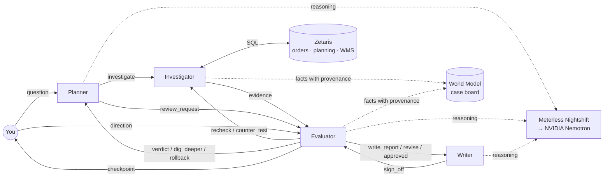

# Chain of Evidence

**Agents that explain why.** *Chain of thought guesses. Chain of evidence proves.*

A team of AI agents investigates why a product ran out of stock at a distribution
centre. The agents challenge each other until every conclusion rests on verified
data, and then they hand the analyst a root cause, the chain of evidence behind it,
and the owner who should act.

Built for the **Open Agent Hackathon 2026 (GenAI.Works)**, Track 2: *The Agent That Can Explain Why*.
Team: **Chain of Evidence** (solo).

---

## The problem

A stockout costs sales the day it happens. Finding out *why* it happened usually costs
an analyst a day or more: the order, planning and warehouse data live in different
systems, the obvious signal is often a symptom rather than the cause, and the final
explanation is rarely traceable back to the numbers.

Single-pass AI makes this worse. It will produce a confident answer from whatever it
sees first, and nothing checks that answer.

## What Chain of Evidence does

You ask, in plain language: *"Why did Herbana shampoo run out in Mumbai?"* (by product, brand,
SKU code, city or event id; vague questions are routed by Nemotron).

1. **The Planner** walks an expert root-cause tree for stockouts (supply, demand,
   inventory policy) and decides what to check next from what has been found so far.
2. **The Investigator** runs each check as SQL through **Zetaris**, joining four
   separate source systems (orders, planning, warehouse, finance) in place.
3. **The Evaluator** challenges everything:
   - recomputes every off-target number independently from the raw rows,
   - refuses "no cause found" and sends the team back to dig deeper,
   - tries to **disprove** each confirmed cause, and **rolls it back** if it is only a symptom,
   - vetoes any report claim that does not match the evidence.
4. **The Writer** first asks the Investigator for the business impact: what it cost, how
   early it was visible, and how much spend on the wrong fix it saves.
5. **You** (optional) review the findings mid-investigation and steer the team, in
   buttons or in your own words.
6. **The Writer** drafts the report, and cannot publish it until the Evaluator signs off.

Every reasoning step runs on **NVIDIA Nemotron through Meterless Nightshift**, and every
model call carries a signed Meterless receipt.

Every answer leads with the business case:

- **What it cost**: demand lost in the 4 weeks from the first stockout, valued at an estimated
  net price, and how often stock ran out again (a cause that is still active).
- **Early warning**: when the cause's signal first went off target, week by week. OOS-001's
  transport delays were visible 21 days before the stockout.
- **Wasted spend averted**: when a cause turns out to be only a side effect, the money the obvious
  fix would have tied up without solving anything. For OOS-001 the obvious fix is to raise safety
  stock: about ₹1.3 lakh of extra stock that would not have stopped the transport delays.
- **A concrete next step** per cause, written from the evidence, with its owner.

## Why it is a system, not a pipeline

The agents talk over a message bus and react to what they receive. There is no fixed
A → B → C sequence: the path through the tree depends on the data, and four feedback
loops send work backwards.

| Loop | From → to | What happens |
|---|---|---|
| Independent recheck | Evaluator → Investigator | An off-target number is accepted only if a second, row-level query recomputes the same value |
| Dig deeper | Evaluator → Planner | "No cause found" is rejected; the Evaluator chooses (with Nemotron) which extra checks to run |
| Counter-test and rollback | Evaluator → Investigator → Planner | Each confirmed cause is tested for whether it is really a symptom; if so the Planner retracts it |
| Report veto | Evaluator → Writer | Every cause and every percentage in the draft must match a measured fact; money comes only from the impact data |
| Analyst checkpoint (optional) | Evaluator ⇄ You | The team pauses, shows its findings and its own recommendation; your direction becomes a message on the bus |



## The three demo cases

Synthetic data for a CPG network: 12 SKUs with fictional brands (personal care, home care, foods) at 3 DCs
(Mumbai, Delhi, Bengaluru), April–September 2026: 936 replenishment orders, 6,588 days of
demand and stock. Six stockouts are planted; the other 30 SKU–DC pairs are healthy controls.
The three demo cases each exercise a different agent behaviour; OOS-004 to OOS-006 show the
same behaviours elsewhere in the network (two more rollbacks, a demand-surge loop, and a
plant short-shipping cause). The expected answers are in
[`data/ANSWER_KEY.md`](data/ANSWER_KEY.md).

For each case below: the **Investigator** runs the checks through Zetaris, the **Evaluator**
challenges the result, and the **Writer** reports the answer once the Evaluator signs off.

**OOS-001 · Herbana Shampoo 200ml (100231) at Mumbai DC.** *What happened:* transport delays from
the plant to the DC.
1. The Investigator finds two possible causes: late deliveries, and stock below the safety-stock
   target on 23.8% of days.
2. The Evaluator asks: did low stock cause the stockout, or did the late deliveries cause the low
   stock? It splits the 12 weeks before the stockout in half. In the first 6 weeks stock was low on
   only 4.8% of days; in the last 6 weeks, after the delays began, on 42.9%.
3. Low stock appeared only after the delays, so it is a side effect. The Evaluator **removes it**,
   and the answer is transport delays alone.

**OOS-002 · Brightwash Liquid Detergent 1L (200118) at Delhi DC.** *What happened:* a recent
demand surge the forecast missed.
1. The Investigator checks all causes over 12 weeks. Every check is within target; demand was only
   6.4% above forecast (the limit is 10%).
2. The Evaluator **rejects "no cause found"**: the shelf ran empty, so something explains it. It
   asks the Investigator to look at just the last 4 weeks.
3. In the last 4 weeks demand was 17.7% above forecast. The surge was real but hidden in the
   12-week average.

**OOS-003 · Crunchies Cream Biscuits 100g (300452) at Mumbai DC.** *What happened:* the
safety-stock target is too low **and** the DC ordered too little.
1. The Investigator finds two causes: the DC ordered 19.6% less than its policy says, and stock
   was below the safety-stock target on 31% of days.
2. The Evaluator runs the same test as in OOS-001: low stock was already there on 35.7% of days in
   the first 6 weeks, before anything else went wrong.
3. So it is a genuine cause, and it **stays**. The answer reports both causes.

Business impact per case (estimated prices in the finance system, `scm_finance.sku_economics`,
net of GST and trade margins):

| Case | Lost in 4 weeks | Stockout days | Early warning | Wasted spend averted |
|---|---|---|---|---|
| OOS-001 | ₹83,315 (877 units) | 4 | 21 days (from 9 Jul) | ₹1,32,000 (extra stock not needed) |
| OOS-002 | ₹4,72,950 (3,153 units) | 6 | 14 days (from 6 Aug) | – |
| OOS-003 | ₹13,403 (1,031 units) | 3 | chronic: off target 8 of 12 weeks | – |
| OOS-004 | ₹5,810 (83 units) | 1 | 35 days (from 2 Jul) | ₹52,000 (extra stock not needed) |
| OOS-005 | ₹1,83,495 (4,705 units) | 5 | 14 days (from 13 Aug) | – |
| OOS-006 | ₹49,010 (338 units) | 4 | 14 days (from 18 Jul) | ₹59,500 (extra stock not needed) |

*Wasted spend averted*: the obvious fix for a stockout is to hold more safety stock. When the team
shows that low stock was only a side effect, that extra stock would have tied up money without
fixing the real cause. The figure is that stock valued at cost.

## Sponsor technology

**Zetaris (data).** The order, planning, warehouse and finance tables live in four separate
Postgres databases, registered in Zetaris as four sources. Every metric is one SQL
statement that Zetaris federates across them. Nothing is copied or pre-joined.
The agents reach Zetaris through its REST API (`POST /api/v1.0/sql-editor/sqls/run`,
see `agent/data_client.py`); each query's SQL, source and timing is kept as evidence.

**Meterless Nightshift (power).** Nightshift is the app's only AI provider. Every model call
(`agent/llm.py`) is an OpenAI-compatible `POST {METERLESS_BASE_URL}/chat/completions` to the
local runtime (default `http://127.0.0.1:8088/v1`) with the runtime token and two headers,
`meterless-app: chain-of-evidence-<agent>` and `meterless-scope: user`. Nightshift routes it
to NVIDIA Nemotron and returns, alongside the answer, a
**signed compute receipt** (routed model, latency, tokens, signer key and signature).
Each call is tagged with the agent that made it (`chain-of-evidence-planner`,
`-evaluator`, `-writer`, `-intake`), so the receipts show which agent reasoned when.
Receipts are saved per run in `logs/<run>/receipts.jsonl` and shown in the web page.
Nightshift's **Scout Intent** engine classifies each request automatically
(visible in the receipts as `scout.mode`).

**Meterless World Model engine.** `agent/world_model.py` implements the engine's three
core services as the team's shared case board:
- `WorldStoreService`: entities (case, hypotheses), facts and relationships;
- `IngestPipelineService`: idempotent, content-hashed ingest of every query result,
  with provenance (the exact SQL, the source, rows returned, query time);
- `ContextBuilderService`: a compact, grounded view of the case for each agent's prompt.

Hypotheses move through states (`testing`, `confirmed`, `rolled back: symptom of …`),
and a rolled-back cause is linked to the fact that refuted it. It powers the counter-test and
rollback feature and the evidence chain on every report.

**Test:** `tests/test_world_model.py` checks each service (provenance on every fact,
idempotent ingest, the append-only trail, hypothesis rollback linked to its refuting fact,
grounded context) and then the engine inside a full investigation. See [Tests](#tests).

**NVIDIA Nemotron** (`nemotron-3.5-lightning-30b-a3b`) does the reasoning: planning the
investigation, choosing where to dig deeper, judging borderline signals, interpreting
the analyst's free-text direction, routing questions to a stockout, and writing the report.

## Running it

### Option A: from a clean clone, no services needed

With no `.env` and no keys, the app falls back to **sample mode** automatically: the bundled
CSVs stand in for Zetaris and a deterministic offline reasoner stands in for Nemotron (the
receipts table says so). Python 3.9+ is all it needs.

```bash
git clone https://github.com/BarshaGuha/Chain-of-evidence.git && cd Chain-of-evidence
python3 -m agent.server                  # open http://localhost:8765
python3 -m agent.main --event OOS-001    # or investigate in the terminal
```

`SAMPLE_MODE=true` forces this mode even when keys are present.

### Option B: live, with Zetaris and Meterless

Prerequisites: Docker Desktop, the local Zetaris platform, Meterless Nightshift with an
NVIDIA provider key, and Python 3.9+.

1. **Load the data** into a local Postgres container (four databases):
   ```bash
   ./data/load_data.sh
   ```
2. **Register the four databases in Zetaris** (Data Explorer → Database → + → PostgreSQL),
   one source per database:

   | Source name | JDBC URL | Tables |
   |---|---|---|
   | `scm_orders` | `jdbc:postgresql://host.docker.internal:55433/scm_orders` | replenishment_orders |
   | `scm_planning` | `jdbc:postgresql://host.docker.internal:55433/scm_planning` | demand_daily, skus |
   | `scm_wms` | `jdbc:postgresql://host.docker.internal:55433/scm_wms` | inventory_snapshots, inventory_norms, stockout_events, dcs |
| `scm_finance` | `jdbc:postgresql://host.docker.internal:55433/scm_finance` | sku_economics |

3. **Configure**: copy `.env.example` to `.env`, then fill in the Nightshift runtime token
   and the Zetaris API key. If you registered a source under a different name, set
   `ZETARIS_SOURCE_*` to match.
4. **Run**:
   ```bash
   python3 -m agent.server                  # web interface, http://localhost:8765
   python3 -m agent.main --list             # stockouts, read live through Zetaris
   python3 -m agent.main --event OOS-002    # one investigation in the terminal
   python3 -m agent.main --all
   ```

Secrets stay in `.env`, which is git-ignored. The NVIDIA key lives only in Nightshift.

Dependencies: `requests` and `python-dotenv` (`pip install -r requirements.txt`) for live mode;
sample mode uses only the standard library.

## Usage: sample inputs and outputs

Ask in plain language on the page (by product, brand, SKU code, city or event id), or in the
terminal with `python3 -m agent.main --event OOS-00X`. Below are three real questions, the answer
the team gives, and each step it took. Every number is computed by a SQL query through Zetaris
over the 12 weeks before the stockout day, unless a step says otherwise.

**What the checks measure** (a check *flags* a possible cause when it crosses its threshold):

| Check | What it means | Flags when |
|---|---|---|
| Fill on-time % | Share of ordered units that arrived in full **and** on time | below 95% |
| Fill rate % | Share of ordered units the plant shipped at all (late or not) | below 95% |
| Lead-time overrun % | How much longer deliveries took than the standard lead time, on average | above 15% |
| Under-forecast error % | How far actual demand exceeded the forecast: (demand − forecast) ÷ demand | above 10% |
| Safety-stock breaches % | Share of days the DC held less stock than its safety-stock target | above 20% |
| Order quantity deviation % | How far the DC ordered below what its stocking policy called for | above 15% |

### Example 1: Brightwash Liquid Detergent 1L at Delhi DC (OOS-002, stockout on 20 Aug 2026)

**Question:** *Why did Brightwash detergent run out in Delhi?*

**Answer:** A recent demand surge that the forecast did not pick up. ₹4,72,950 of sales lost in the
4 weeks from the stockout; the problem was visible 14 days earlier; next step goes to demand planning.

**How the team got there:**

1. **Supply is ruled out.** Fill on-time and fill rate are 99–100%: the plant delivered everything, on time.
2. **The forecast looks fine at first.** Over 12 weeks, demand was only 6.4% above forecast, below the
   10% threshold. A simple checklist would stop here with "no cause found".
3. **The Evaluator rejects "no cause".** A stockout happened, so something explains it. It sends the
   Investigator back to look at a shorter, more recent window.
4. **The last 4 weeks show the problem.** From 23 Jul to 19 Aug, demand was 17.7% above forecast, above
   the 10% threshold. A surge of about 65% that began on 10 Aug was hidden inside the 12-week average.
5. **The number is double-checked.** The Investigator recalculates the 17.7% from the 28 underlying daily
   rows (one row per day: actual demand vs forecast) to confirm the summary query.

### Example 2: Herbana Shampoo 200ml at Mumbai DC (OOS-001, stockout on 30 Jul 2026)

**Question:** *Why did Herbana shampoo run out in Mumbai?*

**Answer:** Transport delays from the plant to the DC. ₹83,315 of sales lost; the delays were visible
21 days before the stockout; it averted ₹1,32,000 of wasted spend on extra stock.

**How the team got there:**

1. **Transport delays are confirmed.** Only 74% of units arrived in full and on time, and deliveries took
   29% longer than the standard lead time (threshold 15%).
2. **Plant short-shipping is ruled out.** Fill rate is 99%: the plant shipped the full quantity, just late.
3. **Low safety stock is also flagged.** The DC was below its safety-stock target on 23.8% of days
   (threshold 20%), so it is confirmed as a second cause.
4. **The Evaluator tests whether it is a cause or a side effect.** It splits the 12 weeks in two:
   breaches were 4.8% of days in the first 6 of the 12 weeks, then 42.9% in the last 6. They started only after the
   delays began (9 Jul), so low safety stock is a symptom of the delays, not a cause.
5. **The safety-stock cause is rolled back.** The final answer names transport delays only. Raising
   safety stock (about 2,400 extra units, ₹1,32,000 at cost) would not have fixed the delays.

### Example 3: Crunchies Cream Biscuits 100g at Mumbai DC (SKU 300452, OOS-003, stockout on 31 Jul 2026)

**Question:** *What happened with SKU 300452?*

**Answer:** Two independent causes: the safety-stock target is too low, **and** the DC ordered less
than its policy called for. ₹13,403 of sales lost; the safety-stock problem was present in 8 of the
12 weeks (a long-running issue, not a recent one).

**How the team got there:**

1. **Supply and forecast are ruled out.** Deliveries were on time and the forecast was unbiased.
2. **Ordering is flagged.** The DC ordered 19.6% less than its stocking policy called for (threshold 15%).
3. **Safety stock is flagged.** The DC was below its safety-stock target on 31% of days (threshold 20%).
4. **The Evaluator runs the same side-effect test as in Example 2.** This time breaches were already
   35.7% of days in the first 6 of the 12 weeks (then 26.2% in the last 6): the problem existed before anything else went
   wrong. It is a genuine cause, so it stays.
5. **Both causes are reported.** Fixing only one would leave the other in place.

A live run on Zetaris and Nemotron (OOS-002, 45 seconds, 30 agent messages) logged these
Meterless receipts, one per model call:

| Agent | Model (routed by Nightshift) | Receipt | Time | Tokens |
|---|---|---|---|---|
| Planner | nvidia/nemotron-3.5-lightning-30b-a3b | rcpt_req_gnzsck3p | 13.6s | 1,324 |
| Evaluator | nvidia/nemotron-3.5-lightning-30b-a3b | rcpt_req_7pr3h2mn | 11.1s | 1,506 |
| Writer | nvidia/nemotron-3.5-lightning-30b-a3b | rcpt_req_2c4vyibf | 13.0s | 1,409 |

Full traces of live runs (every message, every fact with its SQL, every receipt) are in
[`examples/`](examples/).

## Tests

```bash
python3 -m unittest discover -s tests -v
```

Runs in sample mode with the standard library only (about one second):

- `tests/test_world_model.py`: the **Meterless World Model engine** conformance test (7 tests).
- `tests/test_cases.py`: all six stockouts against the answer key: causes, loops,
  rollbacks, sign-off and business impact (3 tests).

```
Ran 10 tests in 0.7s
OK
```

`python3 -m agent.diag` checks the live Nightshift connection: it sends the Writer's request
three times and reports the time, tokens and routed model of each.

## What each run leaves behind

| File | Contents |
|---|---|
| `outputs/<case>.md` / `.json` | The signed-off report: causes, evidence, ruled-out drivers, how the team challenged itself, receipts |
| `logs/<run>/trace.jsonl` | Every agent-to-agent message, in order |
| `logs/<run>/world_model.jsonl` | Every fact with its SQL and source, and every hypothesis state change |
| `logs/<run>/receipts.jsonl` | One signed Meterless receipt per model call |

## Project layout

```
agent/
  agents.py       Planner, Investigator, Evaluator, Writer, You; the message bus and loops
  metrics.py      root-cause tree, metric SQL, independent recheck queries, counter-tests
  world_model.py  Meterless World Model engine: store, ingest, context builder
  llm.py          Nemotron via Meterless Nightshift; receipts; budget escalation
  data_client.py  Zetaris REST client; SQLite sample client
  main.py         command line runner and report writer
  server.py       local web interface (standard library only, live updates via SSE)
  web/index.html  the page
  diag.py         live check of the Nightshift connection
data/
  generate_data.py, load_data.sh, seed_*.sql, csv/, ANSWER_KEY.md
tests/            World Model engine test; answer-key test for all six stockouts
examples/         traces and reports from live runs on Zetaris + Nemotron
```

## Known issues

- **Schema changes at the source need re-registration (observed in the local Zetaris build).**
  Zetaris reads data live, so reloaded rows appeared immediately. When a source table's
  columns changed (we added product master fields to `skus`), queries failed with
  `column "description" does not exist`, because Zetaris kept the column list from
  registration. Refreshing the source did not update it; removing and re-registering the
  source did. Suggestion: a "refresh schema" action per table, or automatic schema detection
  when a query fails this way.

## Limits and next steps

- The root-cause tree is a deliberate slice (8 metrics across 3 branches) of a larger
  stockout tree. Adding a metric means adding one SQL template, one recheck query and a
  tree entry.
- The data is synthetic, built so each case has a known answer to test against.
- Next: more counter-tests (one per cause type), follow-up questions after the report
  ("show me the late orders"), and scheduled runs on every new stockout.

## Credits

- The root-cause tree is inspired by a stockout root-cause framework shared by a
  colleague who is a supply-chain functional consultant. Only the framework idea was used;
  all data is synthetic.
- Built with Claude Code as the AI coding assistant.
- Zetaris, Meterless and NVIDIA Nemotron are the sponsor technologies described above.

## Video 


